

|[:skull:ISSUE](https://github.com/frankyhub/T-Rex/issues?q=is%3Aissue)|[:speech_balloon: Forum /Discussion](https://github.com/frankyhub/T-Rex/discussions)|[:grey_question:WiKi](https://github.com/frankyhub/T-Rex/wiki)||
|--|--|--|--|
| | | | |
<a href="https://github.com/frankyhub/T-Rex/issues">|<a href="https://github.com/frankyhub/T-Rex/discussions">|<a href="https://github.com/frankyhub/T-Rex/6eleases">||
|| <a href="https://github.com/frankyhub/T-Rex/pulse" alt="Activity">| <a href="https://github.com/frankyhub/T-Rex/graphs/traffic">  |<a href="https://github.com/frankyhub?tab=stars"> ||

# T-Rex

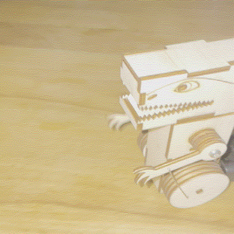
   

 
   

  

## Story:
Das Repo beschreibt die Bastelarbeit "T-Rex". Die Bauteile werden aus einer 3mm Sperrhaltplatte gelasert. Im Gehäuse des T-Rex befindet sich ein Arduino Getriebemotor, dieser wird von zwei AA 1,5V Batterien gespeist.

## Die Stückliste:

| Anzahl | Bezeichnung | 
| -------- | -------- | 
| 1  | Sperrholzplatte 300x600x3mm  | 
|  1 | Getriebemotor  | 
| 1  | Batterie-Case für AA-Batterien | 
|2  |  AA 1,5 V Batterien | 
|  2 |  Holzschrauben | 
| 1  | 0,5 mm Blankdraht | 
| 1  | Holzkleber  | 
| -------- | -------- | 

## T-Rex Lasercuttter Dateien 

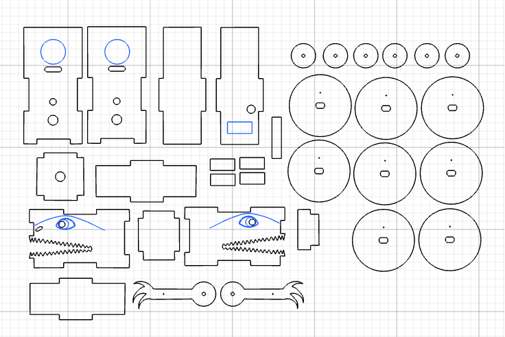 
   

## Montage

Für beide Seitenteile die 3 kleinen Scheiben deckungsgleich verkleben und anschließend auf die blaue Markierung der Seitenwand kleben. 

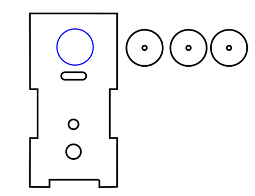 
   

Die beiden Abstandshalter für das Batterie-Case deckungsgleich verkleben und anschließend auf die blaue Markierung der Rückwan kleben.

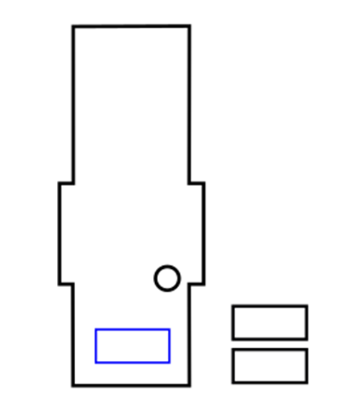 
   

Einen Blankdraht in die kleinen Löcher stecken uns so jeweils 4 Räder deckungsgleich verkleben.  

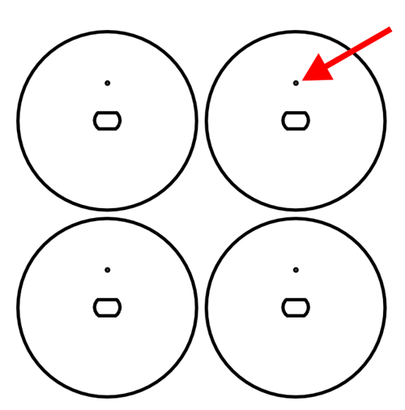 
   

Den Motor und die Anschlüsse des Batterie-Case verlöten. Die Anschlussdrähte zuvor durch das Loch der Seitenwand stecken.
Vor der engültigen Montage des Körpers die Drehrichtung des Motors testen, damit der T-Rex nicht rückwärts läuft.

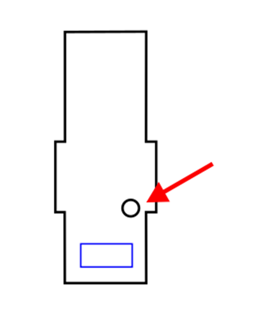 
   

Den Körper zusammenbauen und verkleben. Der Motor muss vor dem endgültigen Verleben im Körper sein.

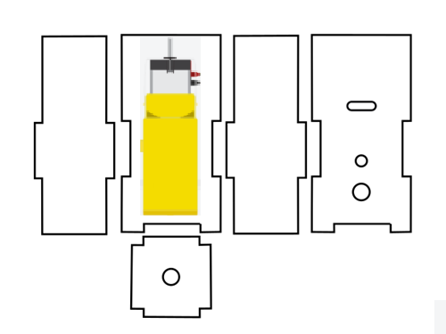 
   

Den Kopf zusammenbauen und verkleben.

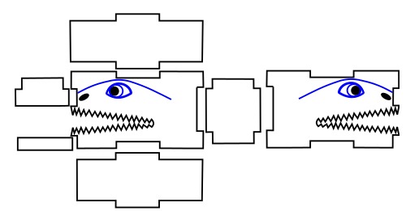 
   

Die beiden Arme an die kleinen Rundlinge schrauben, die Arme müssen dabei beweglich und drehbar sein.
Die beiden Räder auf die Motorachsen stecken.

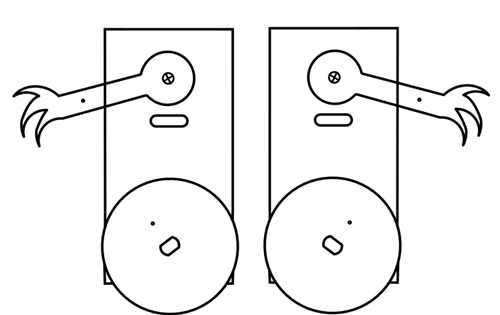 
   

Die Arme und die Räder mit einer Blankdrahtbrücke verbinden.

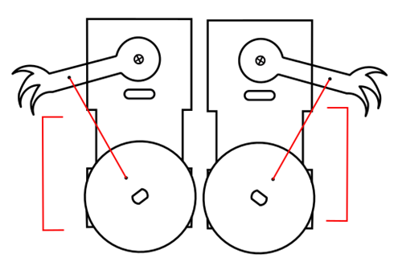 
   

Den Kopf und das Batterie-Case an den Körper kleben.

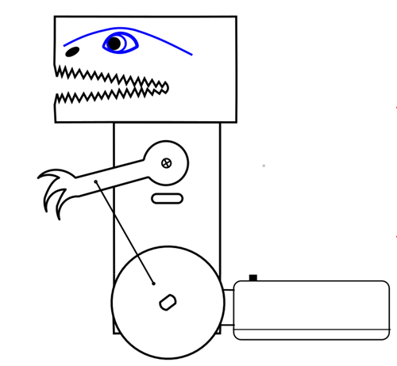 
   

Fertig!

---

   
<ol class="breadcrumb" style="border-top: 2px solid black;border-bottom:2px solid black; height: 45px; width: 900px;"> 
<a href="#oben">nach oben</a>
</ol>

  
