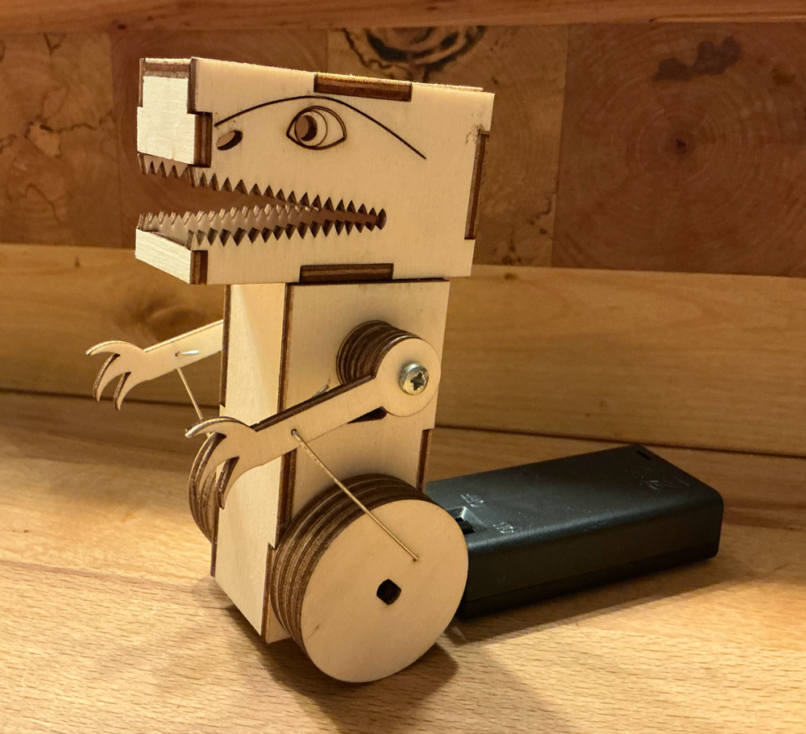

|[:skull:ISSUE](https://github.com/frankyhub/T-Rex/issues?q=is%3Aissue)|[:speech_balloon: Forum /Discussion](https://github.com/frankyhub/T-Rex/discussions)|[:grey_question:WiKi](https://github.com/frankyhub/T-Rex/wiki)||
|--|--|--|--|
| | | | |
<a href="https://github.com/frankyhub/T-Rex/issues">|<a href="https://github.com/frankyhub/T-Rex/discussions">|<a href="https://github.com/frankyhub/T-Rex/6eleases">||
|| <a href="https://github.com/frankyhub/T-Rex/pulse" alt="Activity">| <a href="https://github.com/frankyhub/T-Rex/graphs/traffic">  |<a href="https://github.com/frankyhub?tab=stars"> ||

# T-Rex

 
   

## Story:
Das Repo beschreibt die Bastelarbeit "T-Rex". Die Bauteile werden aus einer 3mm Sperrhaltplatte gelasert. Im Gehäuse des T-Rex befindet sich ein Arduino Getriebemotor, dieser wird von zwei AA 1,5V Batterien gespeist.

## Die Stückliste:

| Anzahl | Bezeichnung | 
| -------- | -------- | 
| 1  | Sperrholzplatte 300x600x3mm  | 
|  1 | Getriebemotor  | 
| 1  | Batterie-Case für AA-Batterien | 
|2  |  AA 1,5 V Batterien | 
|  2 |  Holzschrauben | 
| 1  | Blankdraht | 
| 1  | Holzkleber  | 
| -------- | -------- | 

 
   

---

   
<ol class="breadcrumb" style="border-top: 2px solid black;border-bottom:2px solid black; height: 45px; width: 900px;"> 
<a href="#oben">nach oben</a>
</ol>

  
